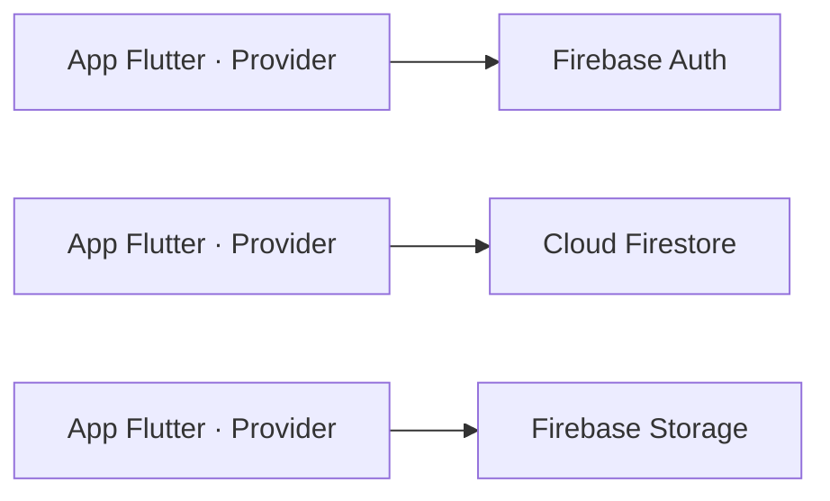

# Alwayz

 

> Aplicação de streaming de filmes e séries em Flutter e Firebase.

> **Estudo de caso.** O código-fonte deste projeto é privado. Este repositório documenta o problema, a solução e as decisões técnicas.

| Campo | Valor |
|---|---|
| Tipo | Aplicação mobile |
| Estado | Fase de testes |
| Papel | Desenho e desenvolvimento ponta a ponta: interface, lógica e integração com os serviços cloud. |

## Resumo

Aplicação móvel de streaming desenvolvida em Flutter, com backend gerido no Firebase, atualmente em fase de testes.

## Problema

Explorar filmes e séries exige uma experiência rápida e organizada. Sem arquitetura clara, uma app de streaming torna-se difícil de evoluir.

## Solução

Uma app modular: estado gerido com Provider, contas com Firebase Auth e catálogo e média na cloud (Firestore e Storage).

## Objetivos

- Oferecer exploração rápida e organizada de filmes e séries
- Manter o código modular para evoluir sem reescrever
- Delegar autenticação e armazenamento a serviços geridos

## Requisitos funcionais

- Registo e início de sessão
- Listagem e exploração de filmes e séries
- Carregamento de catálogo e média a partir da cloud
- Gestão da sessão do utilizador

## Requisitos não funcionais

- Interface fluida e consistente
- Separação entre interface, estado e dados
- Acesso aos dados condicionado por autenticação

## Arquitetura

- **Apresentação:** widgets Flutter e navegação
- **Estado:** Provider, partilha de estado e reatividade da interface
- **Dados:** acesso a Firebase Auth, Firestore e Storage

## Modelo de dados (conceptual)

- `utilizadores`: conta e perfil, ligados ao Firebase Auth
- `catálogo`: filmes e séries com os seus metadados
- `média`: ficheiros no Storage referenciados pelo catálogo

## Fluxos principais

- **Autenticação:** abrir a app → iniciar sessão → Firebase Auth valida → sessão ativa → catálogo
- **Exploração:** catálogo (Firestore) → escolher título → carregar média (Storage)

## Tecnologias

`Flutter`, `Dart`, `Provider`, `Firebase Auth`, `Cloud Firestore`, `Firebase Storage`

## Decisões técnicas

- **Provider para o estado.** É uma solução consolidada no ecossistema Flutter para estado de complexidade moderada, com pouco código repetitivo. *Trade-off:* em apps muito grandes exige mais disciplina de organização.
- **Firebase como backend gerido.** Autenticação, base de dados e ficheiros num único serviço, sem servidor próprio. *Trade-off:* dependência do fornecedor e custos que crescem com o uso.
- **Estrutura modular.** Permite acrescentar funcionalidades sem reescrever o que já existe. *Trade-off:* mais ficheiros e convenções desde o início.

## Segurança

- Autenticação delegada ao Firebase Auth, sem gestão própria de palavras-passe

## Qualidade e estado

- Em fase de testes: validação dos fluxos principais antes de uma versão estável

## Evolução prevista

- Pesquisa e filtros no catálogo
- Favoritos e histórico
- Revisão das regras de segurança do Firestore
- Pipeline de CI para validar cada alteração

## Capturas de ecrã

<!-- Coloque as imagens em docs/ e descomente -->
<!--  -->

## O meu papel

Desenho e desenvolvimento ponta a ponta: interface, lógica e integração com os serviços cloud.

## O que aprendi

Organizar uma app Flutter por módulos e ligar autenticação e dados na cloud de ponta a ponta.

## Contacto

[LinkedIn](https://www.linkedin.com/in/shelton-mindo-64147b34a) · [WhatsApp](https://wa.me/258844573250) · mindoShelton55@gmail.com
