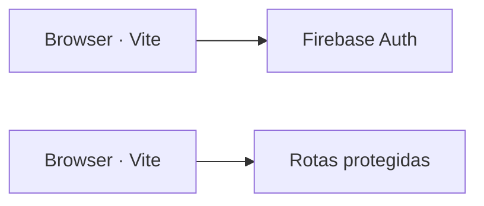

# AuthStarter Pro

 

> Template web reutilizável de autenticação.

> **Estudo de caso.** O código-fonte deste projeto é privado. Este repositório documenta o problema, a solução e as decisões técnicas.

| Campo | Valor |
|---|---|
| Tipo | Template web |
| Estado | Concluído |
| Papel | Conceção e desenvolvimento completo do template. |

## Resumo

Template web concluído que traz a autenticação completa pronta a integrar em novas aplicações.

## Problema

Cada nova aplicação web obriga a refazer do zero o login, o registo e a recuperação de palavra-passe.

## Solução

Um template pronto a usar, com Vite e Firebase, que traz a autenticação completa em minutos.

## Objetivos

- Eliminar o trabalho repetido de autenticação
- Entregar um fluxo completo e seguro
- Ser fácil de integrar em novos projetos

## Requisitos funcionais

- Login e registo
- Confirmação de e-mail
- Recuperação de palavra-passe
- Páginas protegidas

## Requisitos não funcionais

- Reutilizável entre projetos
- Arranque e build rápidos
- Palavras-passe nunca tratadas por código próprio

## Arquitetura

- **Interface:** páginas de login, registo e recuperação (HTML e CSS)
- **Lógica:** JavaScript e controlo de rotas
- **Identidade:** Firebase Auth

## Modelo de dados (conceptual)

- `utilizadores`: geridos pelo Firebase Auth
- Estado de sessão que decide o acesso às páginas protegidas

## Fluxos principais

- **Registo:** formulário → Firebase Auth cria conta → confirmação por e-mail → login
- **Recuperação:** pedido → e-mail de redefinição → nova palavra-passe
- **Acesso:** página protegida → sessão válida? → entra ou volta ao login

## Tecnologias

`Vite`, `JavaScript`, `Firebase`, `HTML`, `CSS`

## Decisões técnicas

- **Vite.** Arranque rápido e build leve. *Trade-off:* menos convenções impostas do que frameworks completas.
- **Autenticação delegada ao Firebase.** Evita código próprio de palavras-passe, a parte mais sensível. *Trade-off:* dependência do fornecedor.
- **Formato de template.** Evita repetir trabalho em cada projeto. *Trade-off:* exige manter e documentar o template.

## Segurança

- Palavras-passe nunca passam por código próprio
- Rotas protegidas para utilizadores autenticados
- Confirmação de e-mail no registo

## Qualidade e estado

- Concluído, com os fluxos principais de autenticação implementados

## Evolução prevista

- Login social
- Autenticação em dois fatores
- Documentação de uso e testes automatizados

## Capturas de ecrã

<!-- Coloque as imagens em docs/ e descomente -->
<!--  -->

## O meu papel

Conceção e desenvolvimento completo do template.

## O que aprendi

Transformar um problema repetido em produto reutilizável.

## Contacto

[LinkedIn](https://www.linkedin.com/in/shelton-mindo-64147b34a) · [WhatsApp](https://wa.me/258844573250) · mindoShelton55@gmail.com
