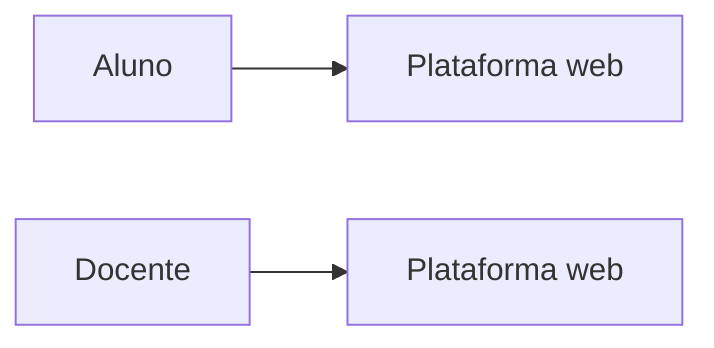

# Educação Digital

 

> Plataforma web que aproxima alunos e docentes.

> **Estudo de caso.** O código-fonte deste projeto é privado. Este repositório documenta o problema, a solução e as decisões técnicas.

| Campo | Valor |
|---|---|
| Tipo | Educação |
| Estado | Em desenvolvimento |
| Papel | Desenho e desenvolvimento do frontend web. |

## Resumo

Plataforma web em desenvolvimento para aproximar alunos e docentes num único espaço digital.

## Problema

A comunicação entre alunos e docentes, os materiais de estudo e o acompanhamento da aprendizagem ficam dispersos.

## Solução

Uma plataforma web que centraliza a comunicação, a partilha de materiais e o acompanhamento num só lugar.

## Objetivos

- Fortalecer a interação entre alunos e docentes
- Centralizar os materiais de estudo
- Facilitar o acompanhamento da aprendizagem

## Requisitos funcionais

- Comunicação entre alunos e docentes
- Partilha de materiais de estudo
- Acompanhamento da aprendizagem

## Requisitos não funcionais

- Acessível em qualquer dispositivo com browser
- Interface simples para dois tipos de utilizador
- Carregamento leve, adequado a ligações lentas

## Arquitetura

- **Apresentação:** HTML e CSS responsivos
- **Comportamento:** JavaScript para interação e navegação

## Modelo de dados (conceptual)

- `alunos` e `docentes`: perfis com necessidades diferentes
- `materiais`: conteúdos partilhados
- `acompanhamento`: progresso da aprendizagem

## Fluxos principais

- **Partilha:** docente publica material → aluno consulta
- **Comunicação:** mensagem entre aluno e docente

## Tecnologias

`HTML`, `CSS`, `JavaScript`

## Decisões técnicas

- **Web com HTML, CSS e JavaScript.** Chega a qualquer dispositivo com browser, sem instalação. *Trade-off:* o frontend sozinho não resolve persistência nem autenticação, que dependem do backend escolhido.

## Qualidade e estado

- Em desenvolvimento: funcionalidades a ser construídas por fases

## Evolução prevista

- Autenticação e perfis por papel
- Notificações de novos materiais
- Painel de acompanhamento para docentes

## Capturas de ecrã

<!-- Coloque as imagens em docs/ e descomente -->
<!--  -->

## O meu papel

Desenho e desenvolvimento do frontend web.

## O que aprendi

Construir uma interface clara para dois tipos de utilizador com necessidades diferentes.

## Contacto

[LinkedIn](https://www.linkedin.com/in/shelton-mindo-64147b34a) · [WhatsApp](https://wa.me/258844573250) · mindoShelton55@gmail.com
