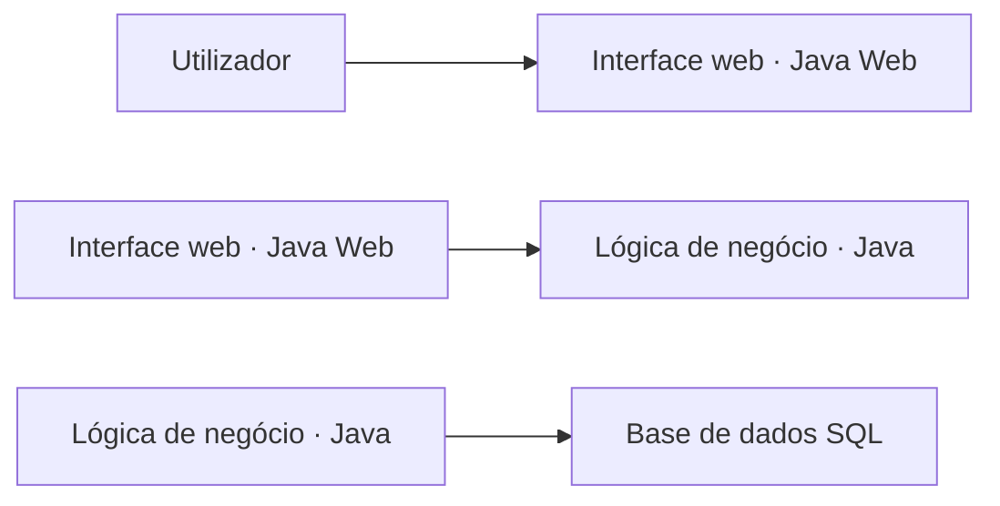

# Sistemas ERP

 

> Sistemas ERP em Java e tecnologias web para gestão empresarial.

> **Estudo de caso.** O código-fonte deste projeto é privado. Este repositório documenta o problema, a solução e as decisões técnicas.

| Campo | Valor |
|---|---|
| Tipo | Gestão empresarial |
| Estado | Implementado |
| Papel | Modelação de dados e desenvolvimento em Java e tecnologias web. |

## Resumo

Sistemas ERP desenvolvidos em Java e tecnologias web, já implementados, para centralizar a gestão de uma organização.

## Problema

Dados e processos espalhados por vários sítios obrigam a trabalho manual e impedem uma visão única do negócio.

## Solução

Um ERP que integra a informação, automatiza processos e centraliza a gestão num único sistema.

## Objetivos

- Integrar dados de diferentes áreas
- Automatizar processos repetitivos
- Dar uma visão única do negócio

## Requisitos funcionais

- Gestão centralizada da informação
- Automatização de processos de gestão
- Consulta e atualização de dados via interface web

## Requisitos não funcionais

- Integridade dos dados
- Separação de responsabilidades por camadas
- Manutenção simples

## Arquitetura

- **Apresentação:** HTML e Java Web
- **Negócio:** regras e processos em Java
- **Dados:** SQL com modelação relacional

## Modelo de dados (conceptual)

- Entidades de negócio modeladas e relacionadas em SQL
- Chaves e restrições para garantir integridade dos dados

## Fluxos principais

- **Pedido:** utilizador → interface web → regra de negócio em Java → consulta ou atualização SQL → resposta

## Tecnologias

`Java`, `HTML`, `Java Web`, `SQL`, `Modelação de dados`, `Gestão de processos`

## Decisões técnicas

- **Modelação de dados primeiro.** Um bom modelo evita redundância e erros mais tarde. *Trade-off:* exige mais análise antes de começar a programar.
- **Arquitetura em camadas.** Separa interface, regras e dados e facilita a manutenção. *Trade-off:* mais código estrutural para um sistema pequeno.
- **Base de dados relacional.** Garante integridade entre entidades relacionadas. *Trade-off:* menos flexível para dados sem estrutura fixa.

## Qualidade e estado

- Implementado e em utilização

## Evolução prevista

- Relatórios e indicadores
- Registo de auditoria das alterações
- Testes automatizados da lógica de negócio

## Capturas de ecrã

<!-- Coloque as imagens em docs/ e descomente -->
<!--  -->

## O meu papel

Modelação de dados e desenvolvimento em Java e tecnologias web.

## O que aprendi

Ligar modelação de dados, regras de negócio e interface num sistema completo.

## Contacto

[LinkedIn](https://www.linkedin.com/in/shelton-mindo-64147b34a) · [WhatsApp](https://wa.me/258844573250) · mindoShelton55@gmail.com
