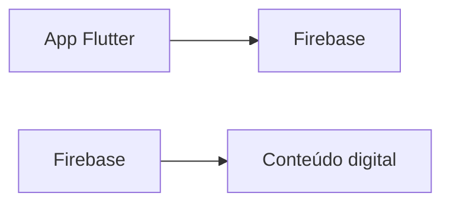

# LivroMoz

 

> Plataforma digital de acesso a livros e conteúdos educativos, com foco na literatura moçambicana.

> **Estudo de caso.** O código-fonte deste projeto é privado. Este repositório documenta o problema, a solução e as decisões técnicas.

| Campo | Valor |
|---|---|
| Tipo | Plataforma de leitura |
| Estado | Fase de testes |
| Papel | Desenho e desenvolvimento ponta a ponta: interface, lógica e integração com os serviços cloud. |

## Resumo

Plataforma digital de leitura pensada para o contexto moçambicano, construída com Flutter e Firebase.

## Problema

Falta acesso fácil a livros e conteúdos educativos, e a literatura moçambicana tem pouca visibilidade.

## Solução

Uma plataforma que liga leitores a livros e conteúdos digitais e dá espaço à literatura nacional.

## Objetivos

- Democratizar o acesso à literatura e ao conhecimento
- Valorizar a literatura nacional
- Reunir livros e conteúdos educativos num só sítio

## Requisitos funcionais

- Contas de utilizador
- Catálogo de livros e conteúdos educativos
- Leitura e consulta de conteúdos
- Destaque para obras e autores moçambicanos

## Requisitos não funcionais

- Conteúdo atualizável sem publicar nova versão da app
- Navegação simples
- Dados guardados na cloud

## Arquitetura

- **Apresentação:** ecrãs de descoberta e leitura
- **Dados:** Firebase para contas e catálogo
- **Conteúdo:** livros e materiais digitais servidos pela cloud

## Modelo de dados (conceptual)

- `utilizadores`: leitores
- `livros`: obras e metadados
- `conteúdos educativos`: materiais de apoio

## Fluxos principais

- **Leitura:** abrir a app → explorar o catálogo → escolher a obra → ler ou consultar

## Tecnologias

`Flutter`, `Firebase`, `Conteúdo digital`

## Decisões técnicas

- **Flutter e Firebase.** É a mesma base usada noutros projetos, o que reaproveita padrões já validados. *Trade-off:* dependência do ecossistema Firebase.
- **Conteúdo tratado como dados.** Acrescentar obras passa a ser uma operação de dados e não uma nova versão da app. *Trade-off:* exige modelo de dados claro e gestão do conteúdo.

## Qualidade e estado

- Em fase de testes, a validar a descoberta e a leitura de conteúdos

## Evolução prevista

- Pesquisa por título e autor
- Marcadores e progresso de leitura
- Modo offline

## Capturas de ecrã

<!-- Coloque as imagens em docs/ e descomente -->
<!--  -->

## O meu papel

Desenho e desenvolvimento ponta a ponta: interface, lógica e integração com os serviços cloud.

## O que aprendi

Pensar um produto cultural: organizar conteúdo, descoberta e acesso.

## Contacto

[LinkedIn](https://www.linkedin.com/in/shelton-mindo-64147b34a) · [WhatsApp](https://wa.me/258844573250) · mindoShelton55@gmail.com
