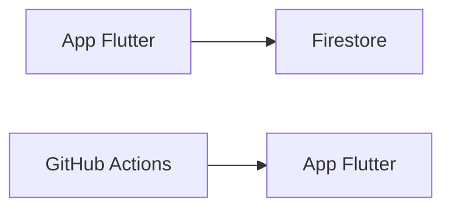

# Maputo Drinks

 

> Marketplace que conecta bottle stores aos consumidores.

> **Estudo de caso.** O código-fonte deste projeto é privado. Este repositório documenta o problema, a solução e as decisões técnicas.

| Campo | Valor |
|---|---|
| Tipo | Delivery de bebidas |
| Estado | Em desenvolvimento |
| Papel | Desenho e desenvolvimento ponta a ponta: interface, lógica e integração com os serviços cloud. Automação do fluxo com GitHub Actions. |

## Resumo

Marketplace móvel em desenvolvimento que digitaliza o comércio de bebidas em Maputo, com automação de integração contínua.

## Problema

As bottle stores têm pouca visibilidade online e o consumidor tem dificuldade em descobrir produtos e encomendar.

## Solução

Um marketplace que reúne estabelecimentos e produtos num só sítio e simplifica a descoberta e a encomenda.

## Objetivos

- Ampliar a visibilidade das bottle stores
- Simplificar a descoberta de produtos
- Reduzir erros com automação do desenvolvimento

## Requisitos funcionais

- Descoberta de estabelecimentos
- Exploração de produtos
- Encomenda simplificada

## Requisitos não funcionais

- Dados que mudam com frequência (produtos, stock)
- Entrega de alterações com menos trabalho manual
- Interface simples em telemóvel

## Arquitetura

- **Apresentação:** app Flutter
- **Dados:** Firestore, orientado a documentos
- **Automação:** workflows em YAML com GitHub Actions

## Modelo de dados (conceptual)

- `estabelecimentos`: bottle stores
- `produtos`: catálogo de cada estabelecimento
- `encomendas`: pedidos dos consumidores

## Fluxos principais

- **Descoberta:** abrir a app → ver estabelecimentos → explorar produtos → encomendar
- **Entrega contínua:** alteração no código → GitHub Actions → validação e testes → resultado visível

## Tecnologias

`Flutter`, `Firebase / Firestore`, `GitHub Actions`

## Decisões técnicas

- **GitHub Actions.** Automatiza validações e testes a cada alteração e reduz erros manuais. *Trade-off:* tempo de configuração inicial dos workflows.
- **Firestore.** Modelo de documentos adequado a dados que mudam com frequência. *Trade-off:* consultas complexas são menos flexíveis do que em SQL.

## Qualidade e estado

- Em desenvolvimento, com automação do fluxo de integração

## Evolução prevista

- Pagamento e entrega
- Painel para bottle stores
- Notificações de encomenda

## Capturas de ecrã

<!-- Coloque as imagens em docs/ e descomente -->
<!--  -->

## O meu papel

Desenho e desenvolvimento ponta a ponta: interface, lógica e integração com os serviços cloud. Automação do fluxo com GitHub Actions.

## O que aprendi

Combinar produto e DevOps: entregar com mais segurança e menos trabalho manual.

## Contacto

[LinkedIn](https://www.linkedin.com/in/shelton-mindo-64147b34a) · [WhatsApp](https://wa.me/258844573250) · mindoShelton55@gmail.com
