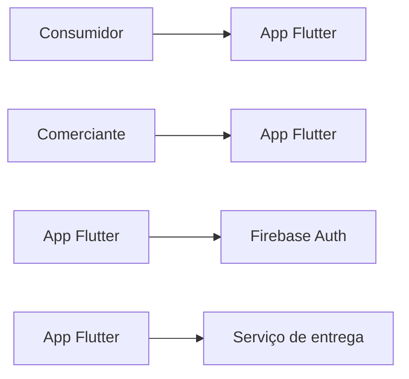

# PayKaya

 

> Marketplace mobile que liga consumidores, comerciantes e serviços de entrega.

> **Estudo de caso.** O código-fonte deste projeto é privado. Este repositório documenta o problema, a solução e as decisões técnicas.

| Campo | Valor |
|---|---|
| Tipo | Marketplace mobile |
| Estado | Fase de testes |
| Papel | Desenho de UI/UX e desenvolvimento da aplicação em Flutter. |

## Resumo

Marketplace móvel em Flutter que liga três intervenientes: o consumidor, o comerciante e a entrega.

## Problema

O comércio local tem pouca presença digital e o cliente não sabe que lojas existem perto dele, nem como encomendar.

## Solução

Um único ambiente onde se descobrem lojas próximas, se exploram produtos e se faz a encomenda com entrega.

## Objetivos

- Dar visibilidade digital ao comércio local
- Permitir descobrir lojas e encomendar num só fluxo
- Integrar a entrega na experiência de compra

## Requisitos funcionais

- Contas seguras de utilizador
- Descoberta de lojas próximas
- Exploração de produtos por loja
- Criação de encomendas
- Acompanhamento da encomenda e da entrega

## Requisitos não funcionais

- Fluxo de compra com poucos passos
- Interface clara em ecrãs pequenos
- Autenticação sem palavras-passe geridas pela aplicação

## Arquitetura

- **Apresentação:** ecrãs de início (lojas próximas), produtos, encomenda e entrega
- **Lógica:** regras do fluxo de compra e dos perfis
- **Serviços:** Firebase Auth para identidade

## Modelo de dados (conceptual)

- `utilizadores`: consumidores e comerciantes
- `lojas`: estabelecimentos descobríveis por proximidade
- `produtos`: catálogo de cada loja
- `encomendas`: itens, estado e entrega associada

## Fluxos principais

- **Compra:** abrir a app → ver lojas próximas → explorar produtos → encomendar → acompanhar a entrega

## Tecnologias

`Flutter`, `Dart`, `Firebase Auth`, `UI/UX`

## Decisões técnicas

- **Descoberta por proximidade como ponto de entrada.** O problema central é o cliente não saber que lojas estão perto. *Trade-off:* depende de haver lojas registadas e de localização disponível.
- **Firebase Auth.** Evita gerir palavras-passe e reduz a superfície de ataque. *Trade-off:* dependência do fornecedor.

## Segurança

- Autenticação delegada ao Firebase Auth

## Qualidade e estado

- Em fase de testes: validação do fluxo completo, da descoberta à entrega

## Evolução prevista

- Notificações do estado da encomenda
- Avaliações de lojas
- Painel para comerciantes

## Capturas de ecrã

<!-- Coloque as imagens em docs/ e descomente -->
<!--  -->

## O meu papel

Desenho de UI/UX e desenvolvimento da aplicação em Flutter.

## O que aprendi

Desenhar um produto com vários tipos de utilizador e transformar um fluxo de compra real em ecrãs simples.

## Contacto

[LinkedIn](https://www.linkedin.com/in/shelton-mindo-64147b34a) · [WhatsApp](https://wa.me/258844573250) · mindoShelton55@gmail.com
