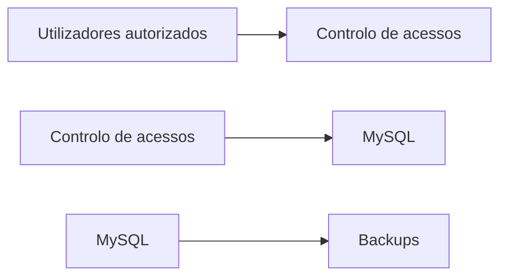

# RAC Seguros: Base de Dados

 

> Base de dados MySQL que substituiu o registo manual em papel.

> **Estudo de caso.** O código-fonte deste projeto é privado. Este repositório documenta o problema, a solução e as decisões técnicas.

> **Confidencialidade.** Trabalho feito para uma empresa real. Não se publicam dados, esquema detalhado nem capturas com informação real.

| Campo | Valor |
|---|---|
| Tipo | Sistema de dados |
| Estado | Implementado |
| Período | 15 jan – 20 jun 2026 |
| Papel | Administrador Júnior de Bases de Dados: modelação, implementação, segurança e backups. |

## Resumo

Trabalho realizado na RAC Seguros, corretora de seguros, de 15 de janeiro a 20 de junho de 2026, como administrador júnior de bases de dados.

## Problema

Os registos viviam em papel: difíceis de organizar, consultar e recuperar.

## Solução

Uma base de dados MySQL modelada de raiz, com acessos controlados, backups e proteção contra ataques comuns.

## Objetivos

- Digitalizar registos que estavam em papel
- Garantir confidencialidade e integridade dos dados
- Assegurar recuperação em caso de falha

## Requisitos funcionais

- Registos digitais estruturados
- Consulta e recuperação rápidas
- Controlo de acessos por perfil
- Backups e restauro

## Requisitos não funcionais

- Confidencialidade dos dados de clientes
- Integridade dos registos
- Recuperabilidade após falha

## Arquitetura

- **Modelo:** esquema relacional construído a partir dos registos em papel
- **Acesso:** perfis e permissões sobre a base
- **Proteção:** encriptação, consultas seguras e backups

## Modelo de dados (conceptual)

- Entidades e relações conceptualizadas a partir de como a informação circulava em papel
- O esquema detalhado não é público, por confidencialidade

## Fluxos principais

- **Digitalização:** registo em papel → modelação → inserção estruturada → consulta
- **Recuperação:** backup → procedimento de restauro → verificação

## Tecnologias

`MySQL`, `Modelação de dados`, `Controlo de acessos`, `Backups e recuperação`, `Encriptação`, `Prevenção de SQL Injection`

## Decisões técnicas

- **MySQL.** Base relacional adequada a registos estruturados e com relações claras. *Trade-off:* exige modelação cuidada desde o início.
- **Controlo de acessos por perfil.** Cada utilizador só acede ao que precisa (menor privilégio). *Trade-off:* mais gestão de contas e permissões.
- **Segurança desde o desenho.** Encriptação e consultas seguras fazem parte da base, não são acrescentadas depois. *Trade-off:* algum custo de desempenho e de complexidade.

## Segurança

- Controlo de acessos por perfil
- Encriptação de dados sensíveis
- Prevenção de SQL Injection
- Backups com procedimento de recuperação

## Qualidade e estado

- Implementado, a substituir o registo em papel

## Evolução prevista

- Testes periódicos de restauro
- Registo de auditoria de acessos
- Monitorização de desempenho

## Capturas de ecrã

<!-- Coloque as imagens em docs/ e descomente -->
<!--  -->

## O meu papel

Administrador Júnior de Bases de Dados: modelação, implementação, segurança e backups.

## O que aprendi

Digitalizar um processo real, com responsabilidade sobre dados sensíveis.

## Contacto

[LinkedIn](https://www.linkedin.com/in/shelton-mindo-64147b34a) · [WhatsApp](https://wa.me/258844573250) · mindoShelton55@gmail.com
